[Nginx](https://nginx.org/en/index.html) 是一款高性能的 HTTP 服务器和反向代理服务器。它的特点是轻量级、高并发、稳定性好，能够处理高负载的情况。很多后端语言(Java/Go 等)都可以单独服务，但在流量处理和负载均衡等方面不如 Nginx 专业和高效，因此 Nginx 通常作为后端服务的流量网关搭配使用。本文，记录下使用笔记。

## 为什么需要 Nginx

很多后端应用都可以独立监听端口提供服务，例如 Java 的 tomcat 就可以独立启用和服务，那为什么还需要 Nginx 呢？主要的原因是，其后端应用对于并发的处理能力有限，而高性能的 Nginx 可以作为流量网关，提前处理和拦截一些请求，减少后端应用压力。例如：

- 静态文件：例如图片、js、css 等，Nginx 可以直接返回静态文件，不需要后端应用处理。
- 负载均衡：Nginx 可以将请求分发到多个后端应用，起到负载均衡的功能。
- 代理缓存：Nginx 可以缓存一些静态文件，例如图片、js、css 等，减少后端应用压力。
- 入口转发：Nginx 支持多种方式的转发，为多种应用提供统一的入口。

Nginx 本质上是一个流量入口，我们在这里为各种请求定义不同的处理策略，以达到高并发等目标。此外，也有不怎么使用 Nginx 的后端应用，例如 NodeJs 异步 IO 就能够支撑高并发场景。

## 快速上手

Nginx 在 Linux/MacOS/Windows 等操作系统上都可以安装，本文内容以 Linux 系统为例。在 Linux 上，Yum/Apt 等包管理器提供有预编译的软件包，但通常都是比较旧的版本，推荐下载源码编译安装，其中一个好处是可以搭配自定义需求进行编译安装。

1. 从 [官网](https://nginx.org/en/download.html) 选择下载：

```bash
wget https://nginx.org/download/nginx-1.22.1.tar.gz
```

以上命令，会下载得到 nginx-1.22.1.tar.gz 文件。Wget 是一个下载工具，可以使用 -O 参数指定保存的文件名，使用 -P 可以指定保存目录(默认当前目录)

2. 解压缩：

```bash
tar zxvf nginx-1.22.1.tar.gz
```

以上命令，会解压得到 nginx-1.22.1 目录。tar 是一个压缩/解压工具，tar 表示 `tape archive` (磁带归档，最初是为了再磁带上存档文件而设计的)，参数：

- z 表示使用 gzip 解压
- x 表示解压
- v 表示进度详情(verbose)
- f 表示文件名(file)。

文件后缀 .tar.gz 表明这个文件用了 2 种工具处理，其中 tar 是用来打包的(把多个文件打包在一起)，gz(gzip) 是用来压缩的(减少文件体积)。


3. 进入解压后的目录，生成编译配置：

```bash
./configure --prefix=/usr/local/nginx
```

以上命令，会生成 Makefile 文件，这是编译工具 make 的配置文件。--prefix 参数指定前缀(解析配置时用到，同时也是安装位置)，默认是 /usr/local/nginx。如果提示缺少依赖，可以使用 apt 等工具安装所需的依赖。

4. 进行编译：

```bash
make
```

以上命令，会生成 objs 目录，里面是编译后的产物。make 是一个编译工具，根据 Makefile 文件，自动编译。

5. 安装：

```
make install
```

以上命令，会把 nginx 安装到 --prefix 指定的目录下。首次安装时，会添加完整的目录和文件；再次安装时，只会覆盖二进制文件等不一样的部分，不会覆盖原有配置文件。

5. 启动 Nginx，可执行文件位于 --prefix 位置的 sbin 目录下，默认以守护进程的方式运行(即后台运行)，可以通过 `-g damon off` 参数以前台方式运行。

```bash
cd /usr/local/nginx/sbin
./nginx
```

6. 浏览器访问服务器 IP，能看到欢迎页面即表示安装成功。如果使用的是云服务器，记得在安全组/防火墙放开 80 端口。

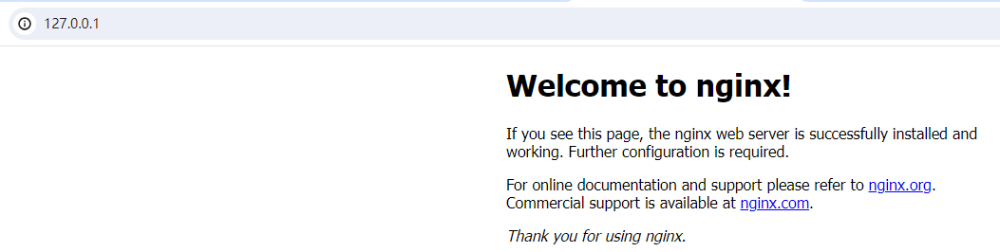

## 目录结构

默认的安装目录结构如下，作为新手我们需要关注注释标注的 3 个文件/目录：

```
├── client_body_temp
├── conf
│   ├── fastcgi.conf
│   ├── fastcgi.conf.default
│   ├── fastcgi_params
│   ├── fastcgi_params.default
│   ├── koi-utf
│   ├── koi-win
│   ├── mime.types
│   ├── mime.types.default
│   ├── nginx.conf                   # 配置文件
│   ├── nginx.conf.default
│   ├── scgi_params
│   ├── scgi_params.default
│   ├── uwsgi_params
│   ├── uwsgi_params.default
│   └── win-utf
├── fastcgi_temp
├── html                             # 站点目录
│   ├── 50x.html
│   └── index.html
├── logs
│   ├── access.log
│   ├── error.log
│   └── nginx.pid
├── proxy_temp
├── sbin
│   └── nginx                        # 可执行文件
├── scgi_temp
└── uwsgi_temp
```

### 可执行文件

即 sbin/nginx 文件，这是我们启动 nginx 的可执行文件，下面是一些用法：

- 启动服务，不用带任何参数，默认以守护进程的方式运行

```bash
./nginx
```

- 关闭服务，s 表示 signal(信号)，这个参数用于向 Nginx 主进程发送信号，以控制 Nginx 的运行状态

```bash
./nginx -s stop
```

- 重启服务，适用于修改完配置并重启的情况

```bash
./nginx -s reload
```

- 检查配置，即检查 conf/nginx.conf 是否有误，t 表示 test。

```bash
./nginx -t
```

- 查看版本, v 表示 version

```bash
./nginx -v
```

### 配置文件

即 conf/nginx.conf 文件，里面的内容由指令组成，主要包含以下几个部分：

```nginx
# 全局配置，例如运行用户、日志位置等
user nginx;
worker_processes 1
error_log /var/log/nginx/error.log warn;

# 事件配置(必须)，告诉 nginx 如何处理连接事件。
events {
  # 每个工作进程可以处理的最大连接数
  worker_connections 1024;
}

# HTTP服务(重点)
http {
  # 根据文件后缀，添加对应的 content-type 响应头
  include       /etc/nginx/mime.types;

  # 服务器配置
  server {
    # 监听端口
    listen       80;
    # 通常是域名，区分不同服务
    server_name juetan.cn;
    # URL匹配
    location / {
      # 网站所在的目录
      root   /usr/share/nginx/html;
      # 索引文件，当访问的路劲以 / 结尾时，会自动添加 index.html
      index index.html index.htm;
    }
  }

  # 可以有多个服务器配置
  server {
    # ...
  }
}
```

### 网站目录

即 html 目录，站点目录(使用其他目录也可以)，通常放的是静态文件，后端接口等动态内容通常不在这里。

当使用静态文件，也就是基于文件系统的站点访问时，通常使用 root 指定位置，如下：

```nginx
server {
  # 监听端口
  listen       80;
  # 通常是域名，区分不同服务
  server_name juetan.cn;
  # URL匹配
  location / {
    # 网站所在的目录
    root   /usr/share/nginx/html;
    # 首页文件
    index index.html index.htm;
  }
}
```

当使用后端服务时，通常使用 proxy_pass 进行代理转发，

## 配置参数

使用 Nginx 的核心就是使用配置文件，一个个讲参数有点乏味，我更喜欢通过案例来了解参数使用，接下来将通过几个典型案例了解其配置。

### 准备工作

以下实践均在 Windows 系统下进行，为了区分不同域名访问，先修改下 hosts 文件，添加 2 个自定义域名：a.com 和 b.com。这 2 个域名尚未启用，不用担心有啥问题。如下：

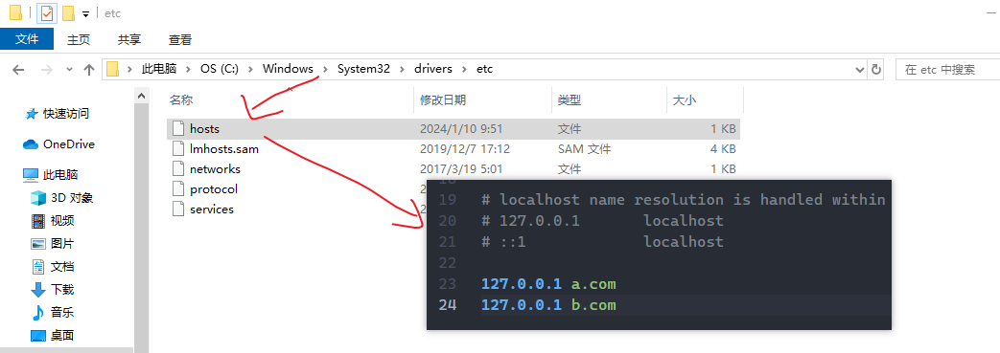

### 域名匹配

一个服务器是可以绑定多个域名的，例如 a.com 和 b.com 都指向 10.10.10.10 时。但在浏览器访问时，域名都会解析成 IP 再发送，也就是 a.com 和 b.com 都往 10.10.10.10:80 发请求，那么 Nginx 如何区分这些服务呢？

这依赖于一个 HTTP 请求头：Host，该字段由浏览器自动携带，表明目标域名或 IP，如下：

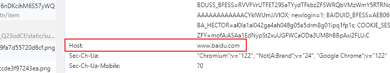

在 Nginx 配置中，可以配置 2 个监听同一端口的服务，Nginx 会根据 server_name 对应的域名或 IP 进行匹配，如下：

```nginx
server {
  listen 80;
  server_name a.com;
  root html/a;
  index index.html;
}

server {
  listen 80;
  server_name b.com;
  root html/b;
  index index.html;
}
```

在 html 目录下，创建如下文件：

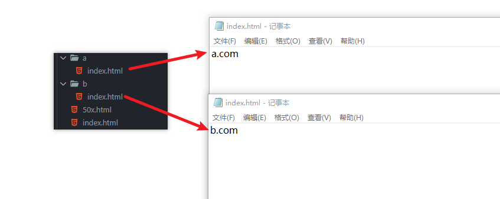

重启 Nginx 后，分别访问 a.com 和 b.com ，效果如下：


以上是在浏览器访问的情况，我们在 Postman 等工具下测试下 Nginx 是不是根据 Host 请求头来区分，以下是正常访问：

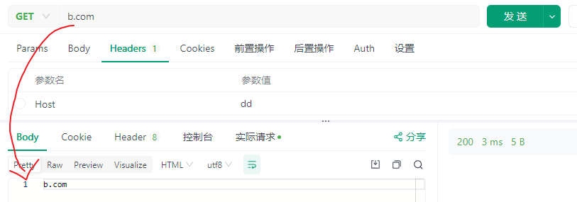

修改 Host 为任意值再访问，如下：

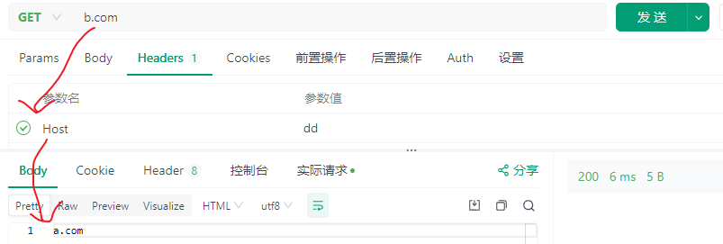

可以看到修改后不再返回 b.com 字样而是 a.com 字样，这证明 Host 对服务匹配是有影响的。而返回 a.com 字样，是因为 server_name 不匹配时，会以第 1 个作为默认服务，

### 获取参数

以 $ 开头的标识符为变量，我们可以通过这些变量拿到请求相关的信息。假设请求地址为：`https://a.com/root?param=value`，那么：

| 变量名          | 变量值            | 描述                                             |
| --------------- | ----------------- | ------------------------------------------------ |
| $request_method | GET               | 请求方法                                         |
| $request_uri    | /root?param=value | 原始 URI                                         |
| $uri            | /root             | 无参 URI                                         |
| $args           | param=value       | 查询参数，通过 $arg_name 可以拿到某个参数        |
| $http_host      | a.com             | Host 头部，通过 $http_heaername 可以拿到某个字段 |
| $remove_addr    | 127.0.0.1         | 请求 IP                                          |

以上列举了常见的变量，完整的变量列表可以参考官方文档：[Nginx 变量列表](https://nginx.org/en/docs/varindex.html)。需要注意，部分变量需启用对应模块才能使用，前面的参考链接里标注有。

### 跨域处理

跨域，其实指的是跨源，而源来自于同源策略中的源，那什么是同源和同源策略呢？ 同源策略是浏览器为了防止跨站脚本攻击而设置的安全策略，在这个策略里：页面只能请求同一来源的内容，例如来源于 A 的页面，不能请求来源于 B 的内容，怎么定义同一来源呢？同一来源，指定是协议、主机名和端口相同。来看以下示例：

```
http://a.com:8000/path?param=value
```

以上，只要请求地址中的 http(协议)、a.com(主机名)和。

在浏览器中，异步请求默认只能请求同一来源的内容，这是浏览器处于安全考虑设置的同源策略。安全，但也不便，于是浏览器又提出跨域资源共享策略(CORS)：浏览器发出异步请求给跨源服务器，如果返回的响应头部包含允许跨域的字段，则返回结果给程序，否则会丢弃响应并报错。在 nginx 中，可以通过 add_header 指令添加这几个字段：

```nginx
http {
  server {
    add_header Access-Control-Allow-Origin *;
  }
}
```

### 并发处理

在 Nginx 中，worker_processes 指定 Nginx 的进程数，默认为 1，worker_connections 指定每个 worker 进程可以处理的最大连接数，默认为 1024。两者乘积即为最大并发数，例如：

```nginx
worker_processes 1;

events {
  worker_connections 1024;
}
```

以上的配置，worker_processes 1，worker_connections 1024，最大并发数为 1 \* 1024 = 1024。需要注意的是，worker_connections 不仅包含与客户端的连接数，还包括代理目标服务器等连接数。

### 文件匹配

静态访问，指一个 URL 对应具体的静态文件(如.html 文件)，而不是像 API 接口这种返回动态内容。我们来看下，一个 URL 是如何对应到具体文件上的，如下：

```
# Nginx配置
location / {
  root html/b
}

# URL匹配
https://b.com/code.html => html/b/code.html
```

以上，当访问 https://b.com 时：`location` 匹配的配置，会拼接到 `root` 指定的路径后面，然后再拼接到我们安装时通过 `--prefix` 指定的路径后面，最终也就是 J:/nginx-1.24.0/html/b/code.html 这个路径。访问效果如下：

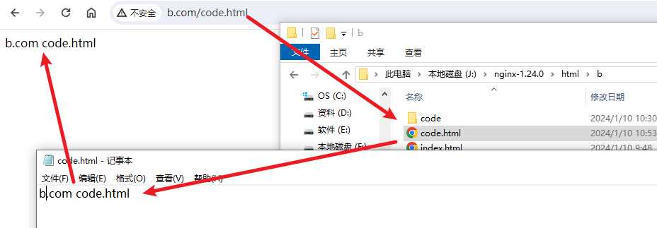

### 目录匹配

当 URL 不以斜杠结尾时表示读取的是文件，而以斜杠结尾时表示读取的是目录。当读取目录时，会返回 index 指令指定的索引文件，默认是 index.html。可以手动指定这个指令，如下：

```nginx
location / {
  index index.html index.htm;
}
```

访问效果如下：

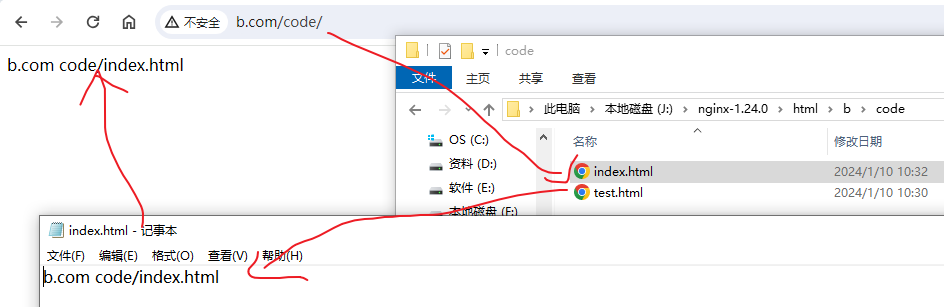

此外，当 URL 不以斜杠结尾时，没有这个文件却有这个目录时，会自动 301 重定向到带斜杠结尾的 URL，如下：

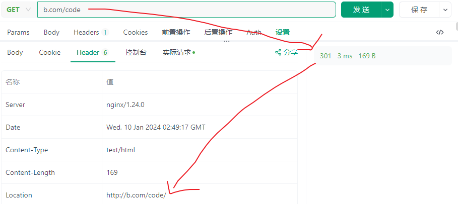

### 单页应用

当部署基于 webhistory 路由的单页应用时，通常会希望除静态文件外的 URL 都指向 index.html 文件。这可以通过 Nginx 的 try_files 指令进行，如下：

```nginx
location / {
  try_files $uri $uri/ /index.html;
}
```

以上，访问时会先尝试匹配文件，然后是目录，最后是 index.html 文件。例如，存在的情况下：

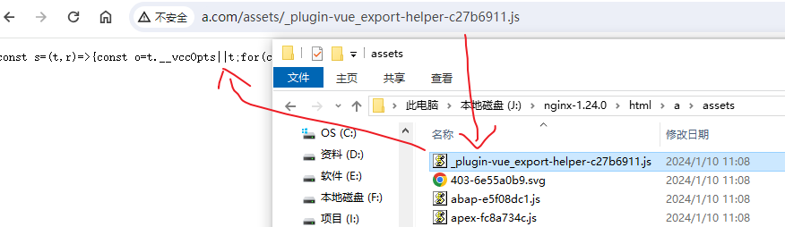

不存在的情况下(如下)，访问 /xxx (不存在)，返回 /index.html 的内容：

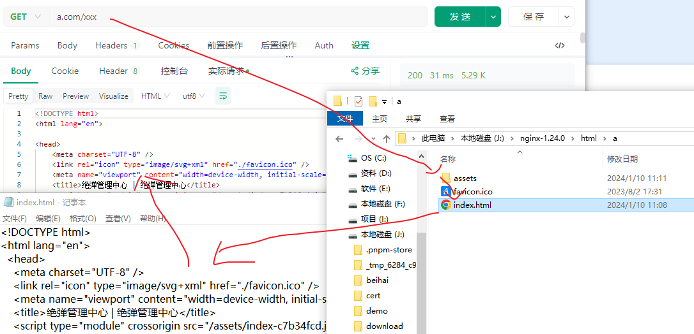

### 自动索引

当访问目录时，通常会读取 index 参数指定的索引文件(例如 index.html)，如果没有 index.html 文件，又想列出当前目录内容，可以使用 autoindex 自动生成索引，如下：

```nginx
http {
  server {
    location /root/ {
      alias /usr/local/nginx/;
      autoindex on;
    }
  }
}
```

### 请求转发

当请求到达 Nginx 时，可以使用 Nginx 内置的方式处理请求，也可以转发给外部的程序进行处理。例如，将 http 请求转发给 Java 的 Tomcat 服务器。除了使用常规的 http/https 协议转发外，Nginx 还支持使用其他的协议转发请求。有些协议比较特殊，专门为 web 服务器设计的。接下来，介绍下：

- proxy_pass: 使用 http/https 协议转发，Nginx 内置有 http 客户端功能。例如，将请求转发给 Java 的 Tomcat 服务器。
- fastcgi_pass: 使用 fastcgi 协议转发，fastcgi 是 cgi 的改进版，使用 c/s 架构，Nginx 内置有 fastcgi 客户端的功能。例如转发给 PHP 的 PHP-FPM 服务器。
- uwsgi_pass: 使用 uwsgi 协议转发，使用 cs 架构，Nginx 内置有 uwsgi 客户端的功能。例如转发给 Python 的 uwsgi 服务器。

以上，proxy_pass 是最简单和通用的，为什么还要引入 fastcgi/uwsgi 等看起来更复杂的方式。那自然是有优势的咯，例如性能和安全性：

- fastcgi 使用常驻内存处理请求，提供更好性能。
- fastcgi 使用 unix socket 与本机上的服务器通信，较少的通信范围提升了安全性。

### 反向代理

所谓代理，简单来说就是这事我不亲自干，我找别人代表我干，这个别人就是代理。所谓正向/反向，其实是站在用户的角度来看的，正向就是代表用户发起请求，反向就是代表服务器返回响应。

在 Nginx 中反向代理主要通过 proxy_pass 这个指令进行配置，proxy 表示代理，pass 表示转发，如下：

```nginx
location / {
  proxy_pass http://127.0.0.1:3000
}
```

proxy_pass 中可以使用变量，支持 http 和 https 协议的转发，参数中是否有路径(即 uri)，会影响到最终的转发地址，如下：

- 参数中无路径，location 匹配并处理过的完整路径，会拼接到 proxy_pass 的参数后面，如下

```nginx
location /api {
  proxy_pass http://b.com
}
# 把 /api/users 拼接到 proxy_pass 的参数后面
http://a.com/api/users => http://b.com/api/users;
```

- 参数中有路径，location 匹配并去掉前缀的路径，会拼接到 proxy_pass 的参数后面，例如：

```nginx
# 情况1
location /api/ {
  proxy_pass http://b.com/apiv1
}
# 把 users 拼接到 proxy_pass 的参数后面
http://a.com/api/users => http://127.0.0.1:3000/apiv1users

# 情况2
location /api {
  proxy_pass http://b.com/apiv1
}
# 把 /users 拼接到 proxy_pass 的参数后面
http://a.com/api/users => http://127.0.0.1:3000/apiv1/users
```

### 负载均衡

负载均衡，指的是同时有多个负载提供服务，请求会经过流量网关(nginx)，再分配到空闲的负载上，起到均衡的作用。主要是应对大流量/高并发的场景。

在 nginx 中可以通过 upstream 指令定义多个上游负载，可以使用 weight 指定权重，如下：

```nginx
upstream mybackend {
  server 127.0.0.1:3000;
  server 127.0.0.1:3001;
}
```

在 proxy_pass 指令中，通过 mybackend 使用上游地址，如下：

```nginx
http {
  server {
    location / {
      proxy_pass http://mybackend;
    }
  }
}
```

这样，请求到达 nginx 时，会随机分配到其中一个负载上。

## 结语

看似简单的 Nginx，其实也有很多门道，但核心内容只有一个：对不同请求使用不同的处理策略。
