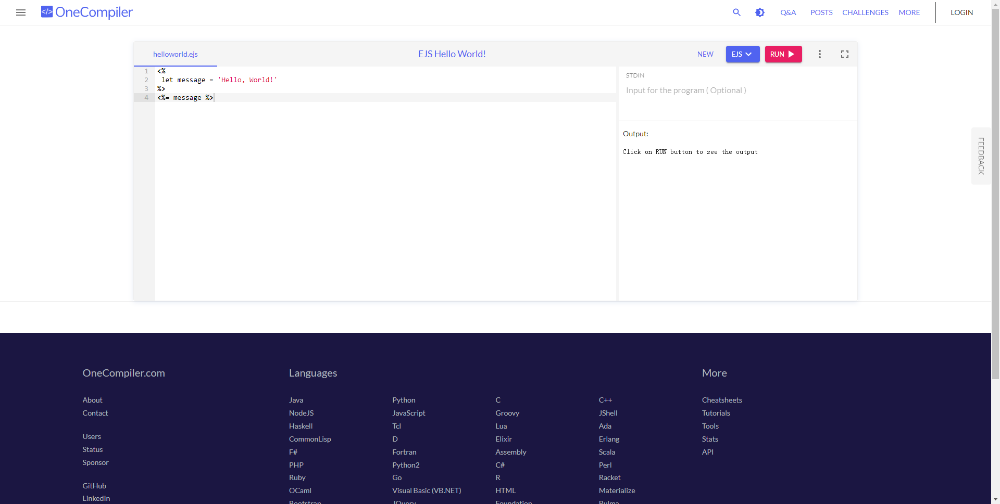

[EJS](https://ejs.bootcss.com/) 是一个 JavaScript 模板引擎，名字中的 E 可以指 Embedded(可嵌入)、Effective(高效)、Elegant(优雅) 或者是 Easy(简单)。 在如今的前端开发中，EJS 比不上 Vue 或 React 等框架强大，但在辅助开发方面还是有用处的。话不多说，接下来以一个例子来感受下。

## 例子

在日常开发中，有时候会遇到后端有一些枚举字典的定义，前端也要进行相应的配置。例如在做权限功能时，后端给了我们下面的权限码数据:

```json
[
  {
    "id": 1,
    "code": "access:readAbc",
    "authName": "读取权限",
    "level": 1
  },
  {
    "id": 2,
    "code": "access:writeAbc",
    "authName": "写入权限"
  }
  ...
]
```

我们需要把他做成枚举的形式, 也就是下面的形式：

```typescript
/**
 * 权限码
 */
export const enum AuthEnum {
  /**
   * 读取权限
   */
  ReadAbc = "access:readAbc",
  /**
   * 写入权限
   */
  WriteAbc = "access:writeAbc",
  ...
}
```

那么如何从这项无聊的工作中解放出来呢，这可以使用 EJS 的模板生成能力。

## 实现

先来看下如何快速得到我们的目标代码。

1.  打开一个能编译 EJS 的在线网站， 例如 [OneCompiler](https://onecompiler.com/ejs)。



2.  根据目标数据结构，编写一丢丢逻辑和模板代码，点击 `RUN` 按钮即可。

```typescript
<%
 let items = [
  {
    "id": 1,
    "code": "access:readAbc",
    "authName": "读取权限",
  },
  {
    "id": 2,
    "code": "access:writeAbc",
    "authName": "写入权限",
  },
 ]
 items = items.map(item => {
   let key = item.code.substring(7);
   key = key.charAt(0).toUpperCase() + key.slice(1)
   return { ...item, key }
 })
-%>
/**
 * 权限码
 */
export const enum DaEnum {
  <% items.forEach((i, index) => { -%>
  /**
   * <%= i.authName %>
   */
  <%= i.key %> = '<%= i.code %>',
  <%_ }) -%>
}
```

## EJS 语法

上面涉及 EJS 的一些语法，我们来简单了解下。<%= name %> 是 EJS 的模板语法，用于执行 JS 代码并输出字符串(部分标签有该功能，看下面)。其中，<% 表示执行一段代码的开始，可以带有修饰符执行特殊功能，包括:

| 标签 | 说明                                                                                                                                   |
| :--: | -------------------------------------------------------------------------------------------------------------------------------------- |
|  <%  | 只执行代码，不包含任何输出                                                                                                             |
| <%=  | 执行表达式，并输出转义后的内容到模板中。转义指对 HTML 标签进行转义，例如 `<%= '<div>ABC</div>' %>` 将输出 `&lt;div&gt;ABC&lt;/div&gt;` |
| <%-  | 同上，但不进行转义。                                                                                                                   |
| <%\_ | 类似于 `<%` , 但会删除前面的空格，例如 `  <%_ 123 %>`， `<%_` 前面有 2 个空格但不会输出，上面第 29 行就用到了这个标签                  |
| <%#  | 注释，后面的内容将会当成注释处理。与 `<!-- ABC -->` 相比，前者不会输出任何内容，后者会保留输出。                                       |
| <%%  | 输出字符串 `<%`                                                                                                                        |

而 %> 表示一段代码的结束，同样可以带有修饰符表示特殊功能，包括：

| 标签  | 说明                                                                                                                            |
| :---: | ------------------------------------------------------------------------------------------------------------------------------- |
|  %\>  | 普通的结束标签，没什么特殊功能                                                                                                  |
| -%\>  | 删除随后的换行符，比较常用的是纯执行的代码块。例如，在上面的第 19/24/29 行 代码中我们就用到了这个标签，不然那里都会有一个空行。 |
| \_%\> | 删除后面的空格符，例如 `<%= 'ABC' _%>  `，`_%>` 后面有 2 个空格但不会输出。                                                     |

此外，任何在 <% 和 %> 标签之外的内容都将会原样输出，更多语法可以参考官方文档。

## 结语

以上这是一个简单的例子，更多用途需要你结合实际多多思考，用好了提效效果明显。除了 EJS，[HandleBars](https://handlebarsjs.com/zh/) 也是一个很流行的 JS 模板引擎，它使用 `{{ }}`语法，对 vue 等框架的用户比较友好。这类模板引擎，在命令行工具进行页面模板的生成方面可能用得比较多，例如 [release-it](https://github.com/release-it/release-it) 就使用 HandleBars 定义 CHANGELOG 的生成模板。

## 为什么需要字符集

字符集是什么？字符的合集，以及字符和码位之间的映射关系。为什么需要字符集？一句话概括，减少存储体积。

现实世界中，有数千种语言，数十万个不同的字符，每个字符在频幕上的显式包含横竖撇捺等绘制信息。如果文件中直接存储字符的完整绘制信息，那么文件体积会非常大。换个思路，如果给每个字符取一个唯一编号(数字)，只存储字符编号，这样文件体积就会大大减小。这样的话：

- 操作系统或软件内部存储字符的绘制信息，以及字符和编号的对应关系。
- 文件存储字符编号
- 读取文件时，根据字符编号找到对应的字符信息，再绘制显式。

上提到的字符、编号、对应关系，是有专业术语的，如下：

- 字符，称为字符(character)。
- 编号，称为码位(code point)
- 对应关系，称为字符集(charset)。

字符和码位如何对应，这个也是有标准的，常见的字符集标准有：

- ascii
- gbk
- big5
- ansi
- unicode

## 为什么需要字符编码

还是一句话，减少存储体积。

上面提到 unicode 最长 3个字节，如果每个字符都用 4 个字节存储，这是最方便的。但是，这也是最费体积的，例如字符 A 明明只需要 1 个字节就能表示，用 4 个字节就会平白浪费 3 个字节，如下：

```
# 1 字节
01000001

# 4 个字节
00000000 00000000 00000000 01000001
```

那么，能不能最低位用1个字节，随着高位增加字节。可以，但有个问题，它们都是混在一起的，如何区分不同的字符?

```
# A你
01000001
```

这时候需要给每个字节的前几位制定一些规则，以表示哪几个字节是一个整体(字符)，例如 utf-8:

- 以 0 开头，表示一个字节
- 以 110 开头，表示两个字节
- 以 1110 开头，表示三个字节
- 以 11110 开头，表示四个字节

以上字符编码的应用大大减少了网络传输的开销。

### 字节序

字节序，指字节的存储顺序(byte order)，分为大端字节序和小端字节序。其中：

- 大端字节序，高位字节存储于内存的低地址，低位字节存储于内存的高地址。符合人类的思维习惯。
- 小端字节序，低位字节存储于内存的低地址，高位字节存储于内存的高地址。符合计算机的思维习惯。

举例：

1. 0x12345678，小端字节序，存储顺序为：78 56 34 12。
2. 0x12345678，大端字节序，存储顺序为：12 34 56 78。

## 字符集

一些名字，既是字符集，也是字符编码，例如 ASCII。

## 结语

字符的绘制信息比较多，如果直接存储体积会很大。通过引入字符集，我们只存储字符码位，减少了存储体积。再通过引入字符编码，将字符码位存储为就近的字节数(不影响解析的情况下)，减少存储体积。

## 装饰器

装饰器，是一种用于装饰类的语法糖，在别的语言中可能称为注解。目前是一项 stage3 的提案，典型的语法的如下：

```ts
@Controller
class UserController {
  handler() {
    return 'hello world';
  }
}
```

实际是这样的：

```ts
function Controller(target) {
  // 代码逻辑...
}

class UserController {
  handler() {
    return 'hello world';
  }
}

Controller(UserController);
```

装饰的位置：

```ts
@Controller()                          // 装饰类(class)
class User {
  @Inject()                            // 装饰类属性(prop)
  name: string

  @Inject()                            // 装饰类访问器(getter)
  get name() {
    return this.name
  }

  @Get('/')                            // 装饰类方法(method)
  addUser(@body() user: NewUser) {}    // 装饰类方法的参数(params)
}
```

## yaml语法

使用缩进表示层级关系，属性名和属性值之间用 冒号+空格(`: `) 分隔。注意：冒号后面必须跟一个空格，否则会被当成字符串。例如：

```yaml
v1:
  v2:0
```

等效于：

```js
{
  v1: "v2:0"
}
```

与 JSON 一样，yaml 支持以下 6 种类型的数据：

- 字符串
- 数字
- 布尔值
- null
- 数组
- 对象

基本语法：

```yaml
# 字符串，双引号可以忽略，有特殊字符时才需要双引号
name: juetan  # 等效于JS：{ name: "juetan" }

# 数字，可以是整数或浮点数
age: 18

# 布尔值
is_admin: true

# 数组，单行写法
arr1: [tom, jerry]
# 数组，多行写法
friends:
  - "tom"
  - "jerry"

# 对象，单行写法
user: {name: "juetan", age: 18}
# 对象，多行写法
user:
  name: "juetan"
  age: 18
```

字符串的额外语法：

```yaml
# 默认情况下会替换换行符为空格
value:
 第一行
 第二行

# 保留换行符
value1: |
 第一行
 第二行

# 保留末尾换行符
value1: |+
 第一行
 第二行
```